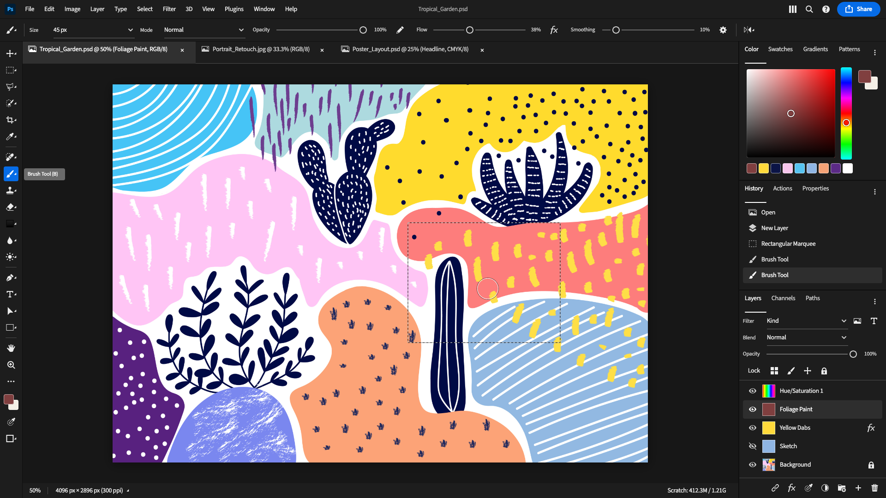
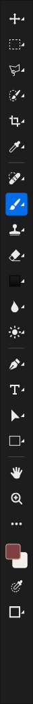
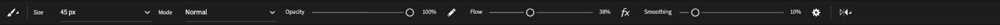
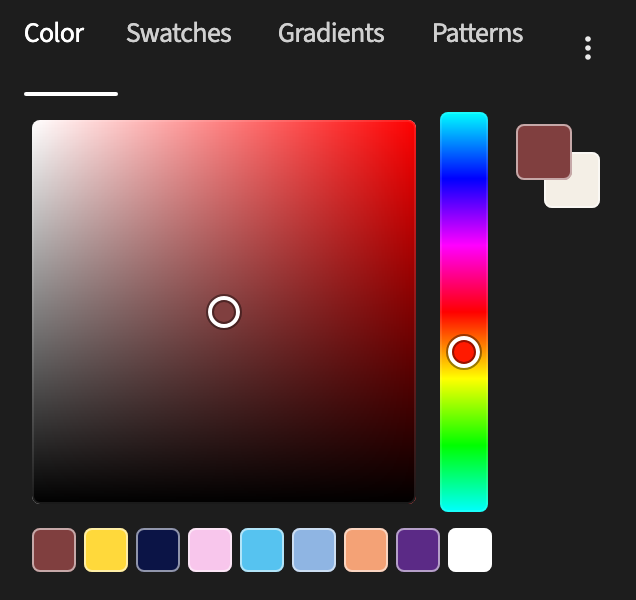
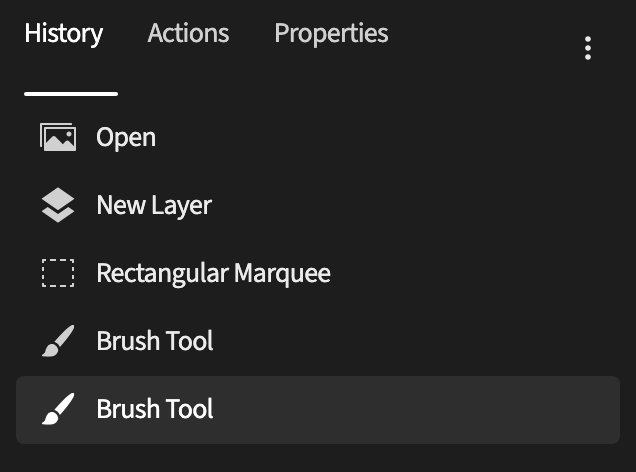
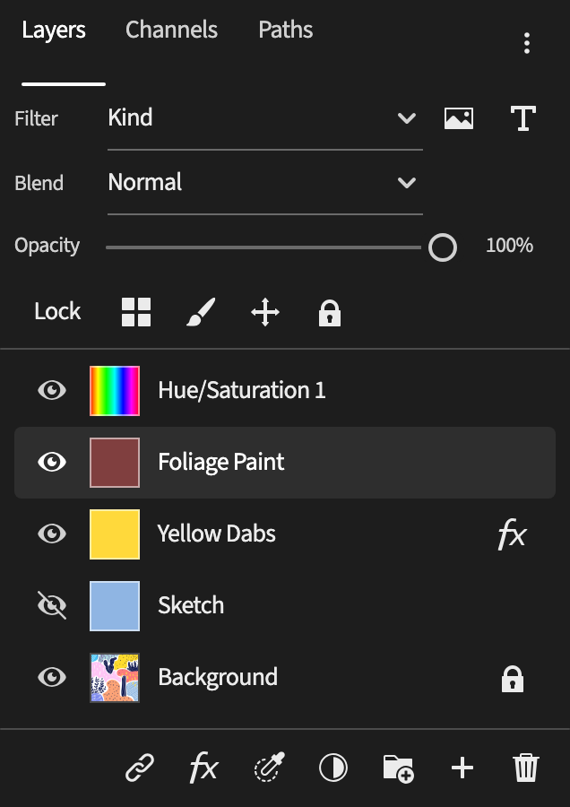
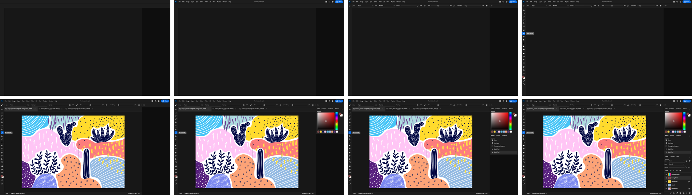
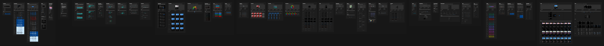

# I told Fanta to recreate Photoshop

An editable, full-desktop Photoshop editing session designed in Fanta by its AI agent, built entirely on top of the **Adobe Spectrum** design kit (Darkest theme). The screen is caught mid-session: the Brush tool is active, a selection is live on the canvas, and the History and Layers panels show the work so far.

The design lives in readable **FNX source** inside a real Fanta project: canvas edits save to the project files, and valid source edits hot-reload onto the canvas.



## Final result

**🖌️ Photoshop Screen**: 1920 × 1080, one frame on its own page.

| Region | Built from Spectrum (Darkest) components |
| --- | --- |
| Menu bar | Quiet **Action Buttons** (File … Help), icon Action Buttons, accent **Button** (Share) |
| Options bar | Quiet **Pickers** (Size, Mode), **Sliders** (Opacity 100%, Flow 38%, Smoothing 10%), **Dividers** |
| Toolbar | 19 icon **Action Buttons** with swapped tool icons and Spectrum's "hold" corner mark; the selected Brush uses the emphasized variant; neutral **Tooltip**; **Swatches** for foreground and background |
| Document | **Tabs** for three open documents, quiet Action Buttons for close and the status bar |
| Color panel | **Tabs**, **Color Area**, vertical **Color Slider** recoloured as a hue strip, recent-colour **Swatches** |
| History panel | **Side Navigation** items, last step selected |
| Layers panel | Pickers, Slider, lock icon buttons, **Side Navigation** items as layer rows with **Swatch** thumbnails, footer icon buttons |

Details:

| Toolbar | Options bar | Color | History | Layers |
| --- | --- | --- | --- | --- |
|  |  |  |  |  |

## How it was made

### Built section by section

The screen was built in eight sections. Each one is its own commit in this repository's history, with a screenshot of the canvas right after Fanta reloaded it:



| Commit | Section | Screenshot |
| --- | --- | --- |
| 1 | Shell and region frames | [stage-1](readme-assets/stages/stage-1.png) |
| 2 | Menu bar | [stage-2](readme-assets/stages/stage-2.png) |
| 3 | Options bar | [stage-3](readme-assets/stages/stage-3.png) |
| 4 | Toolbar and tooltip | [stage-4](readme-assets/stages/stage-4.png) |
| 5 | Document window | [stage-5](readme-assets/stages/stage-5.png) |
| 6 | Color panel | [stage-6](readme-assets/stages/stage-6.png) |
| 7 | History panel | [stage-7](readme-assets/stages/stage-7.png) |
| 8 | Layers panel | [stage-8](readme-assets/stages/stage-8.png) |

Run `git log --oneline` to see them. The first commit is the untouched Spectrum kit, the second adds the build scripts, and each later commit only touches `pages/photoshop-screen/` and its screenshot.

> **About the history:** the design was first built live in one agent session. The commits here replay that build with the final version of `tools/build.py`, one stage at a time against the running app. So the stage contents are exact, but the review fixes from the session (listed below) appear in every stage rather than as later commits.

### Done by editing files

Fanta's MCP canvas operations can place component instances, but cannot change text or icons inside an instance. FNX source can, through per-instance overrides. So the screen was written as source:

1. `tools/build.py` describes the screen in Python and emits `pages/photoshop-screen/page.fnx`.
2. Each candidate is checked with Fanta's `validate_fnx_source` before it is written.
3. Fanta hot-reloads the page about 300 ms after the save, and `get_screenshot` confirms the result.

The new page itself was created the same way: `pages/photoshop-screen/page.json` and `page.fnx` were added on disk, and Fanta picked the page up without a restart.

### Reusing components, not redrawing them

`pages/photoshop-screen/page.fnx` is 173 lines and contains:

| Element | Count |
| --- | --- |
| Component instances | **128** (16 distinct Spectrum variants) |
| Icon swaps inside instances | 64 (43 distinct Spectrum icons) |
| Text overrides inside instances | 57 |
| Override entries in total | 289 |
| Frames (layout regions only) | 15 |
| Drawn shapes and text | 8 |

The 8 drawn elements cover what the kit has no component for: the "Ps" badge text, the document title, the artwork (a rectangle filled with an image already in the kit's assets), the selection outline (two rectangles, black plus white dashes, like Photoshop's marching ants), the brush cursor (two ellipses), and the Background layer's thumbnail (the same artwork image). Two of the 15 frames are also decorative rather than layout: the badge's rounded square and the highlight behind the active document tab.

No existing component or page in the kit was modified. Every change to an instance is an override on that instance, for example:

```jsx
<Instance component="01M4V5T7GTEYT8F9X3G3R3AXKA" name="Size Picker"
  overrides={[
    {"target_path": ["01M4V5T75SC2XKK4WCEC6N8BCV", "01M4V5T75SMXE9WAB6YX45ACY0"],
     "target_prop": {"prop": "text_content"}, "value": {"kind": "text", "value": "Size"}},
    ...
  ]} />
```

### What the review pass fixed

After the first full build the screen was reviewed critically. These were fixed:

- **Uneven menu spacing:** label widths were re-measured with real Source Sans Pro metrics.
- **"Required" asterisks on Pickers:** hidden through overrides.
- **Slider fill stopped short of the handle at high values:** the kit draws track and fill as fixed 200 px vectors. The sliders switched to Spectrum's *No Fill* variant, with the track frame sized to exactly 200 px and the handle placed through the track's padding, so 100% sits at the end of the track.
- **Blue Color Slider:** the vertical Color Slider was recoloured with a hue gradient so it reads as Photoshop's hue strip.
- **Foreground colour didn't match the picker:** the foreground is now the colour under the Color Area's handle.
- **No active document tab:** a lighter tab body marks the active document.

Known gaps: the Tooltip's pointer doesn't render, and Spectrum's tab underline can't stretch through an override, so it is hidden on the document tabs.

## Benchmark: managing the Darkest Theme page

The components came from the kit's **Darkest Theme** page. Finding them meant walking that page through Fanta's live MCP server.

| Scale | |
| --- | --- |
| Nodes on the Darkest Theme page | **8,470** |
| Nodes in the whole document | **74,076** (24 pages) |
| Components in the document | **9,012** |
| Darkest page source (`page.fnx`) | 6.8 MB: 1,281 frames, 773 texts, 649 instances, 377 vectors, 312 rects, 16 ellipses |
| Component masters found on the Darkest page | **1,042** |

| Operation | Median |
| --- | --- |
| Editor state for the whole 74k-node document | 26.7 ms |
| List the Darkest page, 3 levels deep | 10.7 ms |
| Walk the Darkest page tree to find all masters (4,449 nodes, 34 calls) | **95 ms** |
| Page through all 9,012 components | 194 ms |
| Render the Darkest page to PNG (all 8,470 nodes) | ~0.55–0.6 s |
| Render the finished Photoshop screen at 1920 px | 0.86 s |
| Validate the Photoshop page source | 12.4 s |

Measured on an Apple M3 Max with 36 GB of memory, macOS 27, against a **debug build** of Fanta, so release builds should be faster. Validation is the slow step because it materializes the whole 74k-node project to check one page; one of five runs took 94 s. Full numbers and method are in [benchmark/README.md](benchmark/README.md).



## Open and edit

1. [Download Fanta](https://www.fantaisa.net/download) for an Apple Silicon Mac.
2. Clone this repository or download its ZIP and extract it.
3. Open the repository folder as a project in Fanta.
4. Open the **🖌️ Photoshop Screen** page and select **Photoshop — Editing Session**.
5. Edit a layer on the canvas or in its FNX source, then save the project.

The project is large (about 240 MB, 9,012 components), so the first open takes a moment.

### Rebuild the screen

With the project open in Fanta and its live MCP server enabled:

```bash
python3 tools/build.py 8
```

`8` builds all sections; a smaller number builds only the first sections. `python3 tools/bench.py` reruns the benchmark.

## Project files

- `pages/photoshop-screen/`: the Photoshop screen (page metadata and FNX source).
- `tools/fanta.py`: a minimal client for Fanta's live MCP socket.
- `tools/lib.py`: component lookup by family and variant, plus override paths.
- `tools/darkest_masters.json`: the 1,042 Darkest Theme masters and where they live.
- `tools/fnx.py`: FNX writer with instance override helpers.
- `tools/build.py`: the screen, section by section.
- `tools/bench.py`, `benchmark/`: the benchmark and its results.
- `readme-assets/`: final export, stage screenshots and details.
- `components/`, `pages/` (other pages), `assets/`, `doc/`: the Adobe Spectrum kit as a Fanta project.
- `fanta.json`, `fanta.md`, `AGENTS.md`, `fnx.d.ts`: Fanta project files.

## Credits

The components, icons and imagery belong to the **Adobe Spectrum** design system by Adobe. This is an independent design study, not affiliated with or endorsed by Adobe. Photoshop, Illustrator and Spectrum are trademarks of Adobe. See [NOTICE.md](NOTICE.md).

## Try Fanta

- [Fanta website](https://www.fantaisa.net)
- [Documentation](https://fanta-docs.vercel.app)
- [Fanta Community on Discord](https://discord.gg/qrFtymBYxk)
